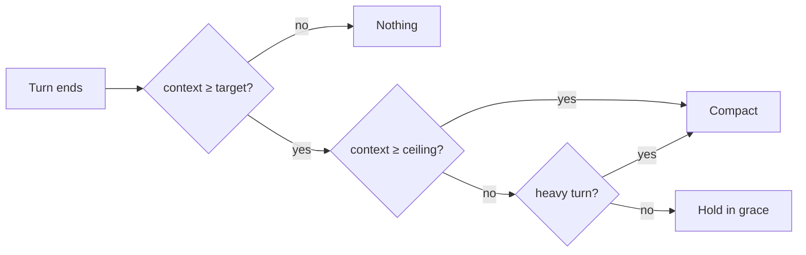

# Kanōn

A ticket-driven, verifier-backed engineering standard for AI coding agents. One canonical source, with generated versions for Claude Code, Cursor, VS Code, Codex and Antigravity.

**Discipline**, as Kanōn uses the word: a named set of rules, roles and checks that the agent follows the same way on every task. Hooks and verifiers enforce it, so nothing depends on the model remembering.

The full guide is the landing page, [`index.html`](index.html).

## Features

Kanōn stays lean by measuring. Every rule earns its tokens, every check runs as code, and every pattern points to its source. The figures below come from this repo's files and the author's own Claude Code transcripts.

- **Distilled from the best public packs.** Benchmarked against [addyosmani/agent-skills](https://github.com/addyosmani/agent-skills), [mattpocock/skills](https://github.com/mattpocock/skills) and [obra/superpowers](https://github.com/obra/superpowers). Kanōn keeps what works and points to them for what they do better. Adam Bien's airails ships vendored for Java. The CLAUDE.md template went from 7.9 KB to 4.2 KB, with every line earning its place.
- **Cost-aware routing and compaction.** Subagents run on Sonnet by default, Opus needs approval, and Fable is held to one bounded task per session. cache-keeper reads your plan (Pro, Max, Team or API) and compacts at your real context floor plus working room, capped per plan. Past that target it adapts: heavy work compacts, a short query holds inside a grace buffer. See [Compaction](#compaction).
- **Visibility in session mods.** Cache time left, context size, 5-hour and weekly use, and session cost show on every turn. Handoff & Clear is one key, and collision-guard asks before you edit a file another session just changed.
- **Layered plugins.** Enable core plus your stack, and nothing else loads. About 1.4–2.5K tokens are fixed per session, not counting MCP tool schemas. Eight tech stack recipes cover Quarkus, Spring Boot, Kotlin, NestJS, Next.js, plain TypeScript and Rust.
- **Audited prompts.** The CLAUDE.md template, agents, skills and rules are audited with `/claude-api prompt-audit` against current Claude models (Opus 5.5, Sonnet 5.5, Fable 5.1), so instructions written for older models get caught. The template is about 1.05K tokens.
- **Deterministic safety gates.** Hooks block unticketed commits, committed session notes, container and database changes by agents, and dependency-cooldown bypasses. CI runs 14 bats tests on them, plus `claude plugin validate`, a leak check and a dist drift check.
- **Verifiers, not opinions.** Reviewers are read-only and quote ArchUnit, dependency-cruiser, clippy and cargo-deny output. Tests prove themselves with mutation testing (PIT, Stryker, cargo-mutants), not a coverage percent.
- **Industry standards, with sources.** Every rule and reference file ends with the source behind each pattern it names: 370 citations across 53 files. Kanōn's own stances are marked *(Kanōn)*.
- **One source, five editors.** Generated dialects for Claude Code, Cursor, VS Code, Codex and Antigravity, plus a paste-in block for plain chat.

## Plugins

| Plugin | Enable in | Brings |
|---|---|---|
| kanon-core | every repo | implementer, backend-architect, architect-review and failure-mode-engineer agents, karpathy-guidelines, adr-manager, commit-craft, common rules, 6 hook checks, Serena MCP, CLAUDE.md/AGENTS.md templates |
| kanon-java | Java/Kotlin repos | Quarkus or Spring Boot, picked from the repo. quarkus-reviewer, spring-reviewer, java-discipline, java rules |
| kanon-java-airails | Java repos, opt-in | 8 vendored [airails](plugins/kanon-java-airails/skills/AIRAILS-NOTICE.md) skills. sbce, ears-tests and continuous-testing run only as slash commands |
| kanon-ts | TS backend repos | nestjs-boundary-reviewer, typescript-discipline, typescript, NestJS and hexagonal rules |
| kanon-web | frontend repos | frontend-discipline, web rules |
| kanon-rust | Rust repos | rust-reviewer, rust-discipline, Rust and axum rules |
| kanon-tools | any repo, opt-in | docker-dev, remove-ai-marks and diagram-on-the-fly skills |
| cache-keeper | any repo (mod) | cache countdown, context size, rate limits, session cost, Handoff & Clear |
| collision-guard | any repo (mod) | asks before editing a file another session just changed |
| prompt-enhancer | any repo (mod) | rewrites a draft prompt into your template, unsent |

The mods need a Claude Code build with hooks modules. The landing page's [Mods section](index.html#mods) covers their buttons, commands and settings.

## Compaction

cache-keeper decides when to compact from three numbers per plan: room, grace and cap. It measures the floor, which is the context size at the first response after a start or a compaction. Then it derives two limits:

- **Target** = floor + room, held at or under cap − grace.
- **Ceiling** = target + grace. It never passes the cap, however high the floor.

Between target and ceiling the decision adapts to the last turn. A turn that added 8K+ tokens or edited 3+ files is work in flight, and the context will keep growing, so compaction pays off now. A short query barely moves the context, so it holds inside the grace instead of paying for a summary it doesn't need. At the ceiling it compacts regardless.


*One verdict per main-loop turn. Subagent turns are ignored.*

| Plan | Room | Grace | Cap | Target / ceiling from a 60K floor |
|---|---|---|---|---|
| Pro | 80K | 5K | 180K | 140K / 145K |
| Max 5x, Team | 130K | 15K | 250K | 190K / 205K |
| Max 20x | 170K | 40K | 300K | 230K / 270K |
| API | 140K | 10K | 250K | 200K / 210K |

Grace keeps the plans' ratio, Pro 1 : Max 5x 3 : Max 20x 8. A light turn adds 1–3K, so Pro holds for a couple of quick questions and Max 20x for a dozen or more. The band's `ctx` reading turns orange past the target and red, with `quality risk`, past the ceiling. Before the first floor is measured it falls back to `warnTokens` (orange) and twice that (red).

Why these numbers:

- **Quality.** Recall falls as context grows, on every model these studies tested ([Chroma](https://www.trychroma.com/research/context-rot), [UIUC, arXiv 2510.05381](https://arxiv.org/abs/2510.05381)). On MRCR v2 8-needle, Opus 4.6 scores 93% up to 256K and 76% at 1M (Sonnet 4.6 system card, Table 2.16.A, [compiled by Klu](https://klu.ai/benchmarks/mrcr-v2)). Caps stay at or under that 256K line, except Max 20x, which buys continuity with some quality risk.
- **Usage.** Each turn re-sends the whole context, and Anthropic says longer conversations use more of your limit ([usage limits](https://support.claude.com/en/articles/11647753-how-do-usage-and-length-limits-work)). Pro runs out of quota first, so it compacts earliest.
- **Continuity.** A summary loses detail and causes re-reads. Max plans have quota to spare, so they keep more raw context.
- **Floor drift.** A plain floor + room rule moves with the floor: a 101K floor put the target at 201K. The cap holds the ceiling in place.

The engine's own auto-compaction fires near the model's window (about 967K on a 1M model), so on its own it almost never fires in time ([compaction internals](https://github.com/anthropics/claude-code/issues/27036)). By default the band only shows the verdict, for example `compact @190k-205k floor 60k (holding: light turn)`. With `enforce` on it asks **Compact**, **Handoff & Clear** or **Keep going** once at a heavy turn past the target and once more at the ceiling. With `autoCompact` on too, it compacts between turns without asking. It never vetoes an engine compaction once the context passes 80% of the model window, so a prompt that is too long still compacts. Override any plan with `compactRoomTokens`, `compactGraceTokens` and `compactCapTokens`.

The thresholds are Kanōn's own reading of these sources, not published figures. No long-context scores are public yet for Opus 5.5 or Fable 5.1, so 256K is a conservative line, not a measured one.

## What Kanōn does not cover

Kanōn holds only its own stance: ticket keys, mutation evidence, read-only reviewers and the hooks that enforce them. For general workflow (brainstorming, planning, TDD, debugging), install one of these alongside it:

- [superpowers](https://github.com/obra/superpowers): `brainstorming`, `writing-plans`, `test-driven-development`, `systematic-debugging`.
- [Matt Pocock's skills](https://github.com/mattpocock/skills): `to-spec`, `tdd`, `diagnosing-bugs`, `code-review`.

## Install

```
/plugin marketplace add themaverik/kanon
/plugin install kanon-core@kanon
/plugin install kanon-java@kanon      # or kanon-ts, kanon-web, kanon-rust
/plugin install kanon-java-airails@kanon   # optional, Java only
/plugin install kanon-tools@kanon          # optional utility skills
```

Claude Code plugins can't ship rules, so sync them into the repo once, and again after each update:

```
python3 scripts/sync-editors.py --repo <repo> --stacks java --tools claude
```

This writes path-scoped rules to `.claude/rules/kanon/`, which Claude Code loads when you touch matching files. Cross-cutting rules go to `.claude/kanon/rules/`, where the discipline skills read them on demand. Reference docs the rules point to go to `.kanon/references/`, for every editor.

Then copy `plugins/kanon-core/templates/CLAUDE.md` and `AGENTS.md` to the repo root and fill in the placeholders, including `Java framework:` for Java repos. To make a repo install the plugins for everyone who trusts it, commit this to `.claude/settings.json`:

```json
{
  "extraKnownMarketplaces": { "kanon": { "source": { "source": "github", "repo": "themaverik/kanon" } } },
  "enabledPlugins": { "kanon-core@kanon": true, "kanon-ts@kanon": true }
}
```

**Other editors:** run `python3 scripts/sync-editors.py --repo <repo> --stacks java --tools cursor`, or copy the matching tree from `dist/`. Add `tools` to `--stacks` for the kanon-tools skills. [Editor-Parity.md](Editor-Parity.md) lists what ports and what doesn't.

**Prerequisites:**
- `uv`, for Serena MCP.
- `python3`, for the hooks.
- Your stack's JDK or Node.
- `graphify` (optional), for the tiered read protocol.

**Settings:**
- `TICKET_REGEX` overrides the ticket-key pattern used by ticket-guard.
- `ALLOW_ENV_MUTATION=1` lets agents run the container and database commands env-mutation-guard blocks, for one session.
- `GRAPH_SYNC_CMD` sets your graphify incremental command.
- `COMMIT_AI=1` turns on AI drafts in the `prepare-commit-msg` git hook. Install that hook with `scripts/install-githooks.sh`.

## Forking

To use your own plugin prefix and org name, run `python3 scripts/rename.py --prefix <your-prefix> --org "<Your Org>" --dry-run`, then run it again without `--dry-run`. Then:
- Add your internal names to `BANNED` and run `scripts/leak-check.sh` in CI.
- Pin a release tag (`v2.0.0`) and enforce it with managed settings. Releases follow semver, and [CHANGELOG.md](CHANGELOG.md) lists what each one breaks.

## License

[MIT](LICENSE). IBM Plex Sans and JetBrains Mono are under the [SIL Open Font License](assets/fonts/OFL.txt).
